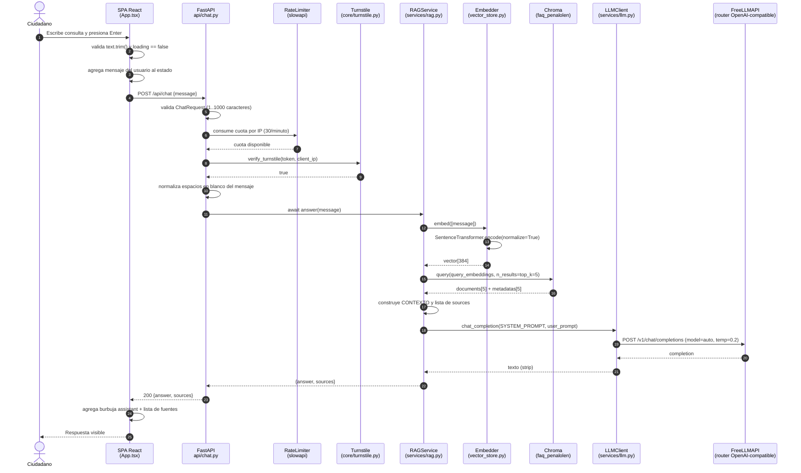
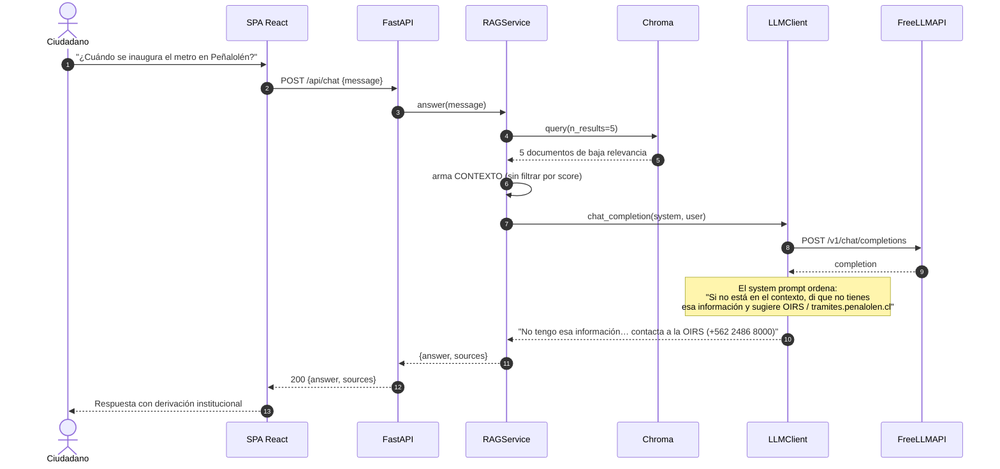
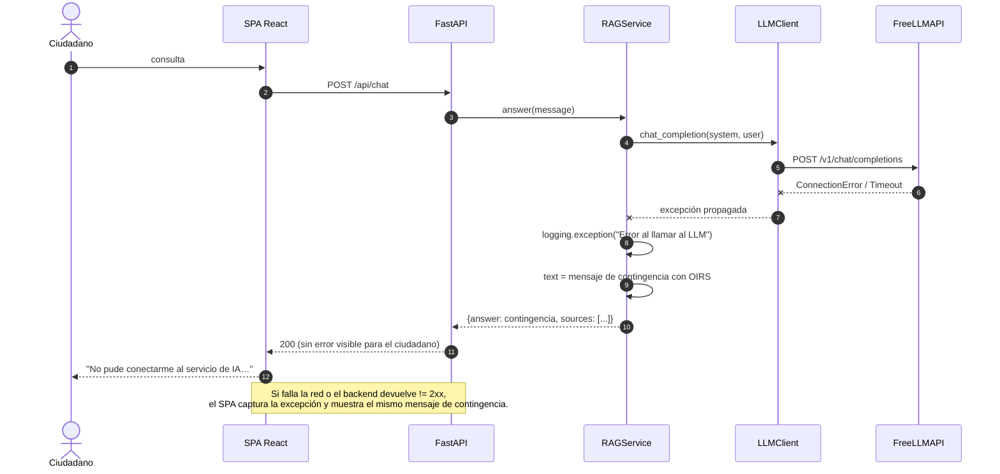
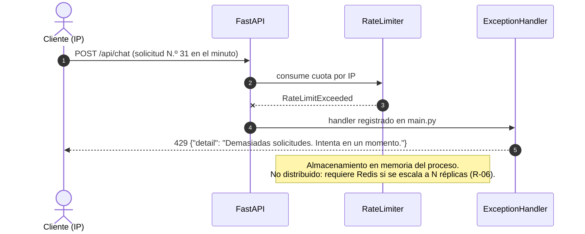
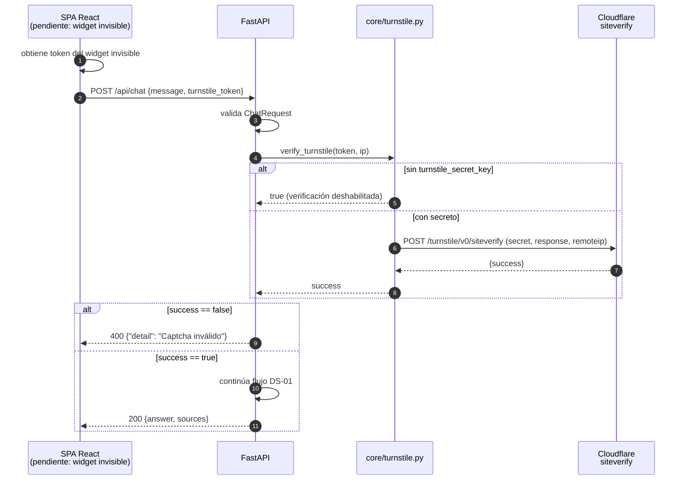
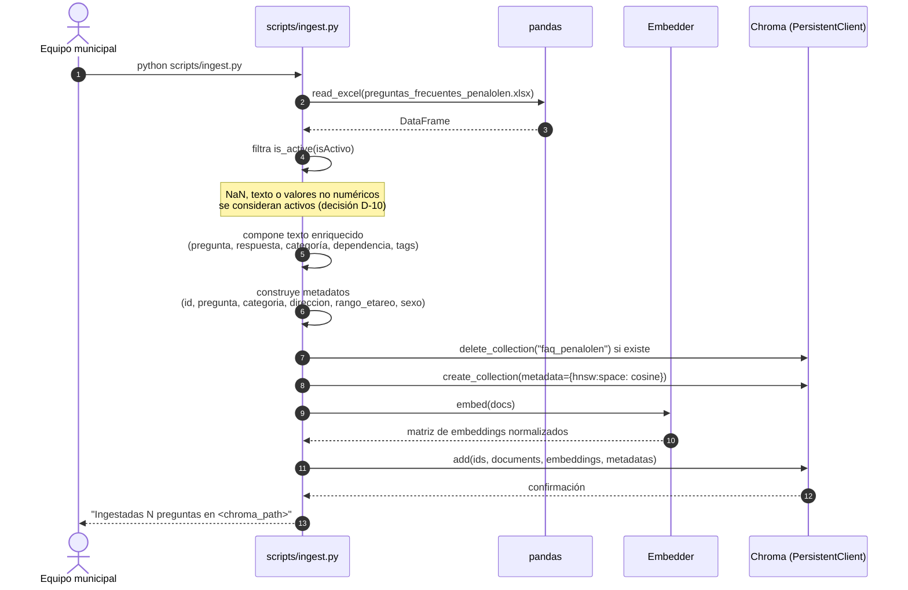
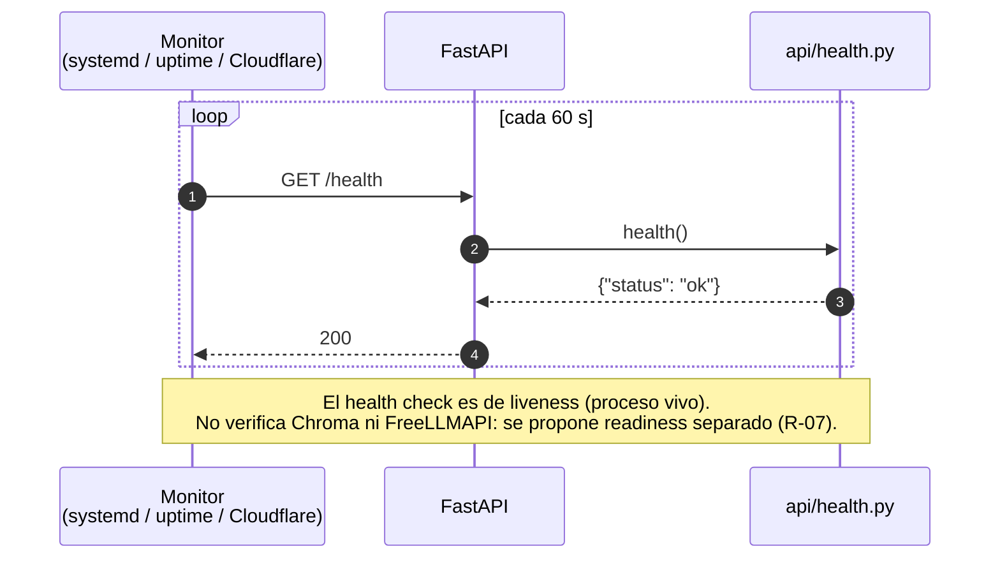

# 01 — Diagramas de secuencia de las principales funcionalidades

Los diagramas se expresan en **Mermaid** (renderizable en GitHub, GitLab, VS Code y
Draw.io). Cada uno describe el comportamiento real del código del repositorio,
incluyendo rutas alternativas y de excepción.

| ID | Funcionalidad | RF | Tipo de flujo |
|----|---------------|----|---------------|
| DS-01 | Consulta ciudadana resuelta con RAG | RF-01, RF-02 | Flujo principal |
| DS-02 | Consulta sin respaldo en la base de conocimiento | RF-03 | Alternativo |
| DS-03 | Caída del proveedor LLM (degradación controlada) | RNF-03 | Excepción |
| DS-04 | Bloqueo por límite de tasa | RF-06 | Excepción |
| DS-05 | Verificación Turnstile | RF-06 | Alternativo |
| DS-06 | Ingesta / actualización de la base de conocimiento | RF-05 | Proceso batch |
| DS-07 | Monitoreo de disponibilidad | RF-04 | Proceso de soporte |

---

## DS-01 — Consulta ciudadana resuelta con RAG (flujo principal)

**Precondición:** el servicio está en ejecución, el índice Chroma contiene la colección
`faq_penalolen` y el router FreeLLMAPI responde.
**Postcondición:** el ciudadano recibe una respuesta en español junto con las fuentes
(pregunta frecuente y dependencia) utilizadas.

**Observaciones de diseño**

- El `session_id` se acepta en el contrato pero **no se utiliza**: el servicio es
  *stateless* y no mantiene historial (decisión D-06).
- El contexto se limita a `top_k = 5` fragmentos para acotar el costo por token y la
  latencia del proveedor.
- La temperatura `0.2` reduce la variabilidad de la redacción municipal.

---

## DS-02 — Consulta sin respaldo en la base de conocimiento

**Disparador:** la consulta es ajena al dominio municipal o no tiene coincidencia
semántica útil.
**Comportamiento actual:** no existe umbral de similitud; Chroma siempre devuelve los
`top_k` vecinos más cercanos. La decisión de "no tengo esa información" recae en el
modelo, guiado por el *system prompt* (decisión D-01 y riesgo R-05).

**Deuda técnica asociada:** incorporar un umbral de distancia coseno (p. ej. `0.35`)
y un mensaje determinista de derivación cuando ningún documento lo supere. Registrado
como CA-05b en el plan de pruebas y R-05 en la matriz de riesgos.

---

## DS-03 — Caída del proveedor LLM (degradación controlada)

**Disparador:** timeout, error HTTP o cuota agotada en FreeLLMAPI / proveedor upstream.
**Resultado:** el endpoint responde `200` con un mensaje institucional, nunca `500`.

---

## DS-04 — Bloqueo por límite de tasa

**Disparador:** la misma IP supera `30` solicitudes por minuto (configurable con
`RATE_LIMIT`).

---

## DS-05 — Verificación Turnstile

**Disparador:** `TURNSTILE_ENABLED=true` (producción) y el cliente envía
`turnstile_token`. Si el secreto no está configurado, la verificación se omite
(*fail-open* controlado por configuración, no por omisión).

**Estado:** backend implementado y probado; la integración del widget en el SPA es
deuda del Sprint 3 (CA-11, CA-12).

---

## DS-06 — Ingesta / actualización de la base de conocimiento

**Disparador:** el equipo municipal actualiza `data/raw/preguntas_frecuentes_penalolen.xlsx`
y ejecuta `python scripts/ingest.py` (operación batch, fuera de línea).

**Características:** idempotente (recrea la colección), determinista para el mismo
Excel y sin dependencia del LLM. Duración típica: ~30 s para 191 documentos en CPU.

---

## DS-07 — Monitoreo de disponibilidad

---

## Resumen de rutas alternativas

| Escenario | Código de respuesta | Mensaje al ciudadano | Diagrama |
|-----------|--------------------|----------------------|----------|
| Consulta válida y LLM disponible | 200 | Respuesta fundamentada + fuentes | DS-01 |
| Consulta fuera de alcance | 200 | "No tengo esa información… OIRS" | DS-02 |
| LLM caído | 200 | Mensaje de contingencia con OIRS | DS-03 |
| Cuota excedida | 429 | "Demasiadas solicitudes…" | DS-04 |
| Captcha inválido | 400 | "Captcha inválido" | DS-05 |
| Cuerpo inválido (vacío o > 1000) | 422 | Error de validación estándar | — |
| Error de red en el navegador | — | Mensaje de contingencia local | DS-03 |
