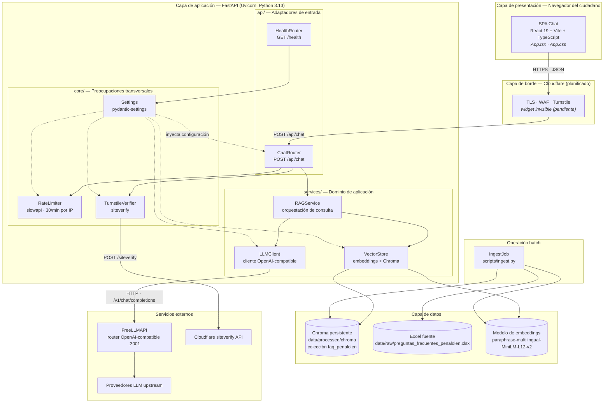
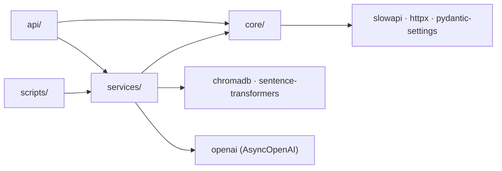
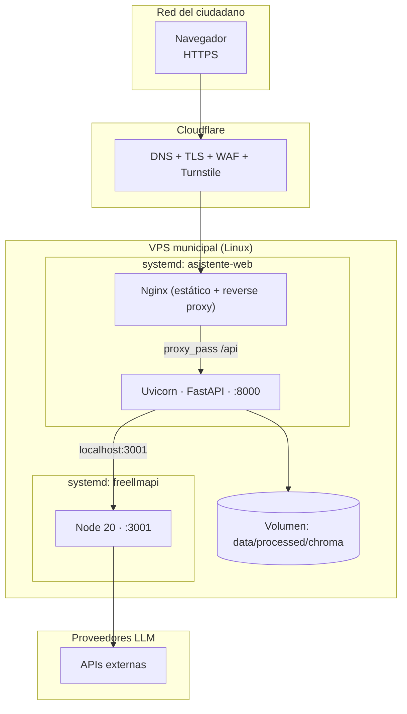

# 02 — Diagrama de componentes

La vista se documenta en tres niveles: **componentes lógicos** (unidades desplegables
y módulos), **dependencias internas** (dirección permitida de importación) y
**despliegue físico** (nodos previstos en el VPS municipal).

---

## 1. Vista de componentes lógicos

**Leyenda de interfaces**

| Símbolo | Significado |
|---------|-------------|
| Flecha continua | Dependencia en tiempo de ejecución |
| Flecha punteada | Inyección de configuración (no acoplamiento funcional) |
| Cilindro | Almacén de datos o artefacto persistente |

---

## 2. Responsabilidades y calidad del diseño

| ID | Componente | Artefacto | Responsabilidad única | Interfaz provista | Interfaz requerida | Cohesión | Acoplamiento |
|----|-----------|-----------|-----------------------|-------------------|--------------------|----------|--------------|
| C-01 | SPA Chat | `frontend/src/App.tsx` | Capturar la consulta, gestionar estado de conversación en memoria y renderizar respuesta + fuentes | UI de chat | `POST /api/chat` | Funcional (alta) | Bajo: solo conoce un endpoint y su DTO |
| C-02 | ChatRouter | `backend/app/api/chat.py` | Validar el contrato HTTP, aplicar cuota y captcha, delegar la respuesta | `POST /api/chat` → `ChatResponse` | `RateLimiter`, `TurnstileVerifier`, `RAGService` | Funcional (alta) | Medio: depende de 3 colaboradores, todos detrás de funciones |
| C-03 | HealthRouter | `backend/app/api/health.py` | Exponer *liveness* del proceso | `GET /health` | — | Funcional (alta) | Nulo |
| C-04 | RAGService | `backend/app/services/rag.py` | Orquestar recuperación + aumento de contexto + generación; aplicar contingencia | `answer(message) -> dict` | `embed`, `get_collection`, `chat_completion` | Funcional (alta) | Medio: 3 dependencias sustituibles |
| C-05 | VectorStore | `backend/app/services/vector_store.py` | Cargar el modelo una vez, generar embeddings normalizados y entregar la colección | `embed`, `get_client`, `get_collection` | `Settings`, disco local | Funcional (alta) | Bajo |
| C-06 | LLMClient | `backend/app/services/llm.py` | Encapsular el protocolo OpenAI y el ciclo de vida del cliente asíncrono | `chat_completion(system, user)` | `Settings`, FreeLLMAPI | Funcional (alta) | Bajo (dependencia de terceros aislada) |
| C-07 | RateLimiter | `backend/app/core/rate_limit.py` | Limitar solicitudes por IP | decorador `limit` | `Settings` | Funcional (alta) | Nulo |
| C-08 | TurnstileVerifier | `backend/app/core/turnstile.py` | Verificar tokens anti-bot contra Cloudflare | `verify_turnstile(token, ip)` | `Settings`, httpx | Funcional (alta) | Bajo |
| C-09 | Settings | `backend/app/config.py` | Centralizar y tipar la configuración por entorno | objeto `settings` | variables de entorno / `.env` | Funcional (alta) | Nulo |
| C-10 | IngestJob | `backend/scripts/ingest.py` | Transformar el Excel en documentos y reconstruir el índice | CLI | `pandas`, `VectorStore`, Chroma | Funcional (alta) | Bajo |
| C-11 | Chroma | dependencia externa | Persistir vectores y metadatos; búsqueda por similitud coseno | API Python de Chroma | disco | — | Reemplazable (puerto `get_collection`) |
| C-12 | FreeLLMAPI | servicio externo | Enrutar la petición al proveedor LLM disponible | API OpenAI-compatible | claves de proveedor | — | Reemplazable (puerto `chat_completion`) |

### 2.1 Evaluación de cohesión y acoplamiento

- **Cohesión:** cada módulo tiene una única razón de cambio. `rag.py` no sabe cómo se
  serializa HTTP ni qué proveedor LLM se usa; `llm.py` no sabe qué es un trámite.
  El único módulo con cohesión mixta es `chat.py`, que mezcla validación de contrato
  con políticas de seguridad; se acepta por ser el *composition root* del endpoint.
- **Acoplamiento:** el acoplamiento hacia dependencias volátiles (Chroma, proveedor LLM)
  es **de datos y por función**, no por tipo concreto: `RAGService` importa funciones,
  lo que permite sustituirlas en pruebas (evidencia: `tests/test_rag.py`).
- **Dirección de dependencias:** `api → services → core/config`; nunca al revés.
  `services` no importa `api`, lo que habilita reutilizar el motor RAG desde un CLI,
  un job o un futuro canal de WhatsApp.

### 2.2 Diagrama de dependencias permitidas

**Regla de arquitectura:** ninguna flecha apunta hacia `api/`. Si se requiere una
regla nueva, se implementa en `services/` o `core/`.

---

## 3. Vista de despliegue (prevista)

**Notas de despliegue**

- El frontend se publica como artefacto estático (`frontend/dist`), servido por Nginx;
  no requiere proceso Node en producción.
- FreeLLMAPI queda en `localhost`, sin exposición pública; solo el backend lo consume.
- Chroma vive en un volumen persistente; el índice se regenera con el job de ingesta,
  por lo que no requiere respaldo transaccional (el Excel es la fuente de verdad).

---

## 4. Trazabilidad componentes ↔ requerimientos

| Requerimiento | Componentes involucrados |
|---------------|--------------------------|
| RF-01 | C-01, C-02 |
| RF-02 | C-02, C-04, C-05, C-06, C-11, C-12 |
| RF-03 | C-04, C-06 |
| RF-04 | C-03 |
| RF-05 | C-10, C-05, C-11 |
| RF-06 | C-02, C-07, C-08 |
| RNF-04 (mantenibilidad) | C-04, C-06, C-09 (puertos sustituibles) |
